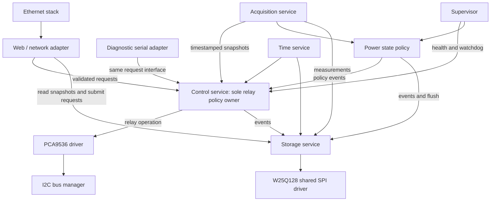

# SmartSwitch firmware architecture — design draft

Status: **proposed, not implemented or approved**. 2026-11-23. This is an integration contract for maintainers and AI agents, not evidence of board behavior. Existing bring-up code remains authoritative for current behavior until migration is agreed and implemented. Preserve uncommitted work; do not change generated code outside USER CODE areas. See `AGENTS.md` and `docs/*-bringup.md` first. The project has one human developer; agents must coordinate changes through the interfaces below.

## 1. Purpose and open decisions

Control four electrical loads; report available electrical measurements and status; serve a web UI through Ethernet connected to a 4G router, normally using DHCP. On loss of mains, battery power supports continued status collection and logging until an intended 30% capacity threshold, followed by power saving. Exact behavior at that threshold is **undecided**. SOC cannot yet be inferred accurately from the available uncalibrated battery voltage alone.

Unresolved before implementation: assembled schematic/PCB revision and contact wiring; channel mapping and interlocks; relay behavior on boot, reset, supply loss, fault and recovery; battery chemistry/cell count/capacity and supply budget; actual low-power wake and rail control; measurement circuits and availability on battery; duration and rate of backup logging; what remains awake below the threshold; router power and network exposure; authentication/TLS, update and recovery policy. No diagram here authorizes energizing loads or changes safety behavior.

## 2. Architecture and dependencies

Arrows are logical dependencies, not permission for arbitrary synchronous calls. Drivers provide mechanisms, services own policy. Network or serial code must not directly manipulate output drivers; acquisition does not own safety decisions. Avoid cyclic synchronous calls: publish events or queue requests, with bounded waits.

## 3. Ownership contracts

An owner is the only component allowed to mutate a resource. Bus managers and drivers own the mechanism; the service owns decisions. Ownership applies to production and diagnostic paths. All public interfaces run in task context unless explicitly designated ISR-safe. DMA buffers must reside in DMA-accessible SRAM, remain valid until completion, and never reside in CCM.

| Resource / state | Single owner | Others interact through | Contract / failure |
|---|---|---|---|
| Relay policy, requested pattern, transition state | Control service | Bounded command queue; copied status snapshot | Accept/reject with request ID; serialize commands and interlocks; no uncontrolled direct PCA writes. On failure report physical state unknown. |
| PCA9536 registers | PCA driver, invoked for outputs only by Control | I2C manager | Read-modify-write protected over full transaction. Register/pin readback does not confirm contacts. Preserve or change startup output only after policy agreed. |
| I2C1, DMA and HAL callbacks | I2C bus manager | Task-context transaction API under one bus mutex | One in-flight transaction; bounded timeout; release lock in every path. Existing timeout latches fault until reset; recovery design required. Other devices must use same manager. |
| SPI2, both flash CS, DMA and callbacks | W25Q128 shared bus driver | Storage service; bootloader owns exclusively before scheduler | Serialize both chips and any future SPI clients. Existing mutex covers busy polling; task waits bounded; uncertain write/erase requires recovery and readback. Never bypass lock. |
| Persistent partitions, config, event/log records | Storage service | Queued requests and copied results | Sole allocator/writer, explicit partitions and versioned records. Atomic commit, integrity and recovery to be designed; current contents are not presumed blank. |
| ADC2 scan, DMA buffer and sample freshness | Acquisition service | Immutable copied snapshot or request | One continuous-DMA owner; sequence/freshness and ADC error tracked. No second DMA starter. Snapshot marks unknown/stale/out-of-range; calibration and channel mappings require schematic verification. |
| Ethernet MAC, ETH IRQ, PHY and network stack | Network service / CycloneTCP driver | Network service API and stack sockets | Existing HAL PHY probe hands ownership to CycloneTCP sequentially; no concurrent HAL MAC init. Link events, bounded startup/recovery, DHCP/static state owned here. |
| USART6 TX and its HAL completion callback | Debug log service | Task-context logging API | Existing DMA logger is best effort and can drop data. Not a persistent audit log; callback must be dispatched if shared. |
| USART6 RX DMA and parser | Diagnostic serial adapter | Submit requests to services | Existing diagnostic SET currently writes hardware directly; migrate before enabling alongside Control. Disable or gate dangerous commands in production. UART recovery required. |
| RTC and time validity | Time service | Time snapshot and set/sync requests | Single writer, UTC internally; indicate invalid/unsynchronized time and source. Preserve backup domain after validation; existing init resets date/time. |
| Power measurements and state | Power policy service | Acquisition snapshot, GPIO events, published state | No claimed SOC without validated method; invalid/stale data drives an explicitly agreed conservative policy. GPIO raw polarity must be verified. |
| Health registry and watchdog feed decision | Supervisor | Heartbeat/progress reports from essential services | Feed only if required services progress within state-specific windows. Hardware/external watchdog wiring and action must be verified. No arbitrary service feeds watchdog. |
| Runtime configuration | Configuration owner within Storage | Immutable versioned snapshots; explicit validated update | No shared writable pointers. Network changes are staged and acknowledged, with fallback still to be designed. |
| HAL IRQ/callback symbols and NVIC priorities | Peripheral owner with central dispatcher if shared | ISR-to-task notification / semaphore | Exactly one definition per HAL callback. ISRs do minimal work; RTOS FromISR calls require FreeRTOS-compatible NVIC priority. Audit after CubeMX regeneration. |

State snapshots are copied under a short mutex or critical section; do not expose pointers to mutable DMA buffers. No lock is held while waiting for a queue, disk/flash, network, callback, or another service. Bus locks protect only bus/device transactions; do not take application locks while acquiring bus locks. Publish events after releasing locks. For power-loss-sensitive records, queue acceptance is not durable commit: acknowledge durability only after verified commit.

## 4. Proposed execution model

These are logical tasks and relative priorities, not finalized numeric priorities or a request to create every worker now. Smaller priority rank below means more urgent; map to FreeRTOS numbers only after stack and latency measurements. No task spins while waiting. Network-stack internal tasks and existing debugTx are additional; audit their actual priorities and memory usage.

| Task | Priority class | Responsibility and blocking |
|---|---|---|
| Control | High | Own relay state machine, validate/serialize commands and process fault/power events. Blocks on queue with bounded operation deadlines; never waits for flash/network. |
| Acquisition / power | Medium-high | Own ADC DMA, freshness, signal processing and power-state evaluation; publish copied snapshots and events. Sample rate and filtering are TBD. |
| Supervisor | Medium-high | Check progress deadlines and state-dependent health; decide watchdog feed. Do not starve it with continuously runnable higher-priority tasks. |
| Network / web | Medium | Stack/link/DHCP and request/response handling; network worker count depends on stack implementation. Never hold sockets/locks while waiting indefinitely. |
| Storage | Low-medium | Serialize flash records, config and update staging; bounded queue and device timeouts; signal durable completion. Account for erase latency and power budget. |
| Diagnostics | Low | Existing debug TX/RX; adapt serial requests to service interfaces. Logs may drop; reserve queue capacity for essential events separately. |

Time service can initially be a module called by supervisor/network with one owner; no separate task is required. FreeRTOS timer callbacks only notify tasks, never block or perform flash/network work. Queue lengths and stack sizes are engineering budgets to derive from burst rate, worst-case flash erase/transfer, concurrent requests, measurements, high-water marks and margin. Instrument task stack high-water, heap current/minimum, queue high-water/drop counts and fault counters under worst-case load. CMSIS-RTOS2 stack size is in bytes; native FreeRTOS stack depths are words on this target. Monitor malloc failure and overflow hooks, verify they have useful safe behavior, and avoid allocation in critical paths after initialization where practical.

## 5. Interfaces and concurrency semantics

Proposed names, not existing APIs:

* `Control_Submit(request_id, channel, desired_state, source)` returns accepted/rejected/busy; later status is pending/applied/failed/unknown. Request acceptance is not relay actuation. Duplicate requests must be idempotent or deduplicated, including after client timeout. Fault and power events require a reserved path or capacity and cannot silently disappear behind normal commands.
* `Control_GetSnapshot()` returns desired state, last confirmed expander readback, transition/fault and separately contact feedback only if verified hardware supports it; otherwise contact status unknown. Hardware I2C errors invalidate confidence.
* `Acquisition_GetSnapshot()` returns value, unit, raw value as appropriate, monotonic sample time, validity, age and calibration/version. Voltage, current and input status require verified circuit mappings. No zero substitution for unavailable sensors.
* `Storage_Submit(record, durability)` returns queued/busy; a separate completion reports committed/failed. Bounded queue full policy distinguishes critical events from ordinary samples; use counters and aggregation to avoid flash wear. Reserve energy/time for shutdown commit only after measurement.
* `Time_Get()` returns UTC if valid plus monotonic uptime, source and quality. Store both monotonic and time-quality metadata; timezone affects presentation, not stored UTC.
* `Network_GetSnapshot()` returns link, address mode, IP, DHCP state and errors. DHCP failure, provisioning/fallback and config rollback are TBD; do not silently expose insecure recovery services.

Queues transfer commands/events by value with bounded capacity; mutexes protect bus and short snapshot updates; binary semaphores or task notifications signal DMA/ISR completion; event flags represent level state, not a durable event stream. Distinguish timeout from cancellation: caller timeout does not prove operation stopped. Every async request has an ID and observable outcome; never blindly repeat a potentially non-idempotent operation.

## 6. Startup, state and recovery

Proposed startup: reset cause and minimal safe hardware initialization → validate memory/config/time without overwriting RTC → start scheduler and resource owners → establish actual device/readback and power state → Control applies **approved** boot policy → start network and web only when required services are ready → Supervisor starts state-specific watchdog supervision. Each step has bounded timeout and degraded/fault reporting. Existing PCA output-preserving init is current behavior, not an approved product policy. Hardware defaults before firmware runs must be assessed separately.

Power policy states: `STARTUP`, `MAINS_NORMAL`, `BACKUP`, `LOW_POWER_PREPARE`, `LOW_POWER`, `RECOVERY`, `FAULT`. Transitions depend on validated input status, voltage/SOC quality, hysteresis and delays; exact behavior, including relay policy, logging cessation, wake sources and power rail capability, is unresolved. LOW_POWER_PREPARE should request a bounded storage flush and await a durable result when energy permits; a failure must be recorded as far as feasible, never wait forever. A network or logger failure must not automatically change a relay without an approved rule.

Control model separates `requested`, `pending`, `expander_readback`, and `contact_feedback` (unknown unless measured). For I2C timeout, reset during transition, or no feedback, do not assert contact state. No numerical switching delays or interlocks are specified until hardware and load requirements are confirmed. State and commands survive resets only as explicitly designed; stored prior command does not automatically authorize re-energizing a load.

## 7. Network, security and updates

DHCP is the initial deployment assumption; static IP, unique MAC provisioning, address recovery and behavior on lease/link loss remain design items. A 4G router is not a security boundary: document exposure, remote access and administrator roles. Decide HTTP versus HTTPS based on threat model, authentication/session and certificate lifecycle, measured memory and product requirements. Command endpoints need authorization, validation, replay/duplicate protection and explicit outcome; browser disconnect is not proof a command failed.

FOTA is a future design milestone, not an implemented guarantee. Two W25Q128 chips were observed, 16 MiB each; their existing contents and production partition ownership are unknown. Define staging, bootloader sectors, recovery, signed image verification and anti-rollback after measuring application size and agreeing on recovery constraints. CRC detects accidental corruption; signature authenticates trusted firmware. Test interruption at each erase/program/commit step. Never erase flash for testing unless its ownership and reserved area are established.

## 8. Migration and validation gates

No firmware changes are authorized by this draft. Before implementation inspect `git status` and diff, preserve all existing modifications and untracked files, and agree on migration. Current key deviations: diagnostic SET directly accesses PCA; default task and bring-up code own several initializations; RTC init resets time; ADC backup command starts ADC2 DMA; network uses temporary static IP/MAC; I2C timeout faults until reset. A phased integration must eliminate competing ownership before enabling the new services, preserve callback dispatch, and keep the hardware in an agreed state. Check CycloneTCP licensing and security support before product use.

1. Confirm schematic revision, power/relay behavior and measurements without operating loads; document observed vs assumed facts.
2. Specify service interfaces, fault policy, event priority, stack/heap budget and initial memory map; review before changes.
3. Migrate ownership one resource at a time with host/unit tests for state logic, then bench tests without AC/load; verify no duplicate callbacks or bypass paths.
4. Test I2C/SPI/ADC timeout and concurrency, stale measurements, queue saturation, reset and power interruption; retain timestamped logs, build identifiers, equipment and pass/fail evidence.
5. Exercise Ethernet/DHCP, UI authorization and disconnect cases; test relay/contact behavior and real loads only under an agreed safe bench procedure. Separately test endurance and firmware recovery.

Baseline references: `docs/debug-logging.md`, `docs/ethernet-bringup.md`, `docs/flash-bringup.md`, `docs/pca9536-bringup.md`, `docs/backup-command.md`, `docs/serial-protocol.md`; `F407_smartswitch/F407_smartswitch.ioc`, `Core/Src/main.c`, `Core/Inc/FreeRTOSConfig.h`, `STM32F407VGTX_FLASH.ld`. Bring-up results are scoped in those documents and must not be generalized to production validation.
