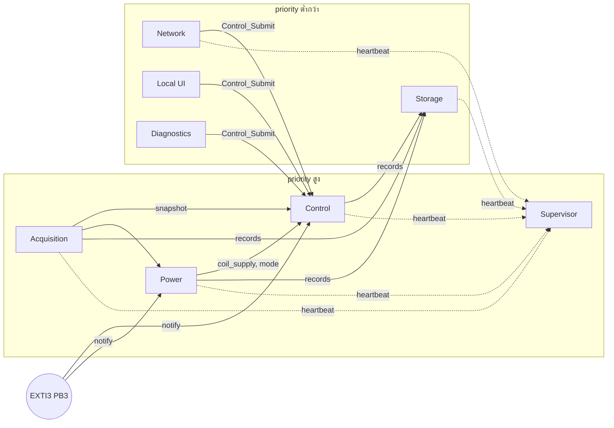

# SmartSwitch firmware architecture (v1)

สถานะ: **ตกลงแล้วจากการ review 2026-11-23 แต่ยังไม่ได้ implement** โค้ด bring-up ปัจจุบัน
(tag `bringup-baseline`) ยังเป็นตัวบอกพฤติกรรมจริงจนกว่าแต่ละ phase ใน
[migration-plan.md](migration-plan.md) จะเสร็จ เอกสาร bring-up ใน `docs/*.md` อธิบาย
"สิ่งที่โค้ดทำตอนนี้" ส่วนโฟลเดอร์นี้อธิบาย "สิ่งที่จะเป็น"

อ่านไฟล์นี้ก่อนเสมอ แล้วอ่านเฉพาะไฟล์ของ task/driver ที่จะแก้

## 1. ระบบทำอะไร

บอร์ด STM32F407VG คุมรีเลย์ 220 VAC 4 ช่อง (RT314024, หน้าสัมผัส **NC**) ในตู้ telecom
outdoor วัดแรงดัน AC หลังรีเลย์ทุกช่อง (AMC3330) กระแส 1 จุด (CT) และ VBAT
มี web UI ผ่าน Ethernet ที่ต่อกับ router Teltonika RUTM51 ในตู้ และมีจอ OLED 128×32
พร้อมปุ่ม 2 ตัวสำหรับช่างหน้างาน

- coil มีไฟ = โหลด **OFF**, coil ไม่มีไฟ = โหลด **ON**
- ไฟ coil (`+24Vcoil`) มาจาก 24 V ของตู้เท่านั้น ไม่ได้มาจากแบต
- use case หลัก: remote power-cycle อุปกรณ์ที่ค้าง และสั่ง OFF/ON ค้างได้
- router ไม่ได้ต่อผ่านรีเลย์ใน v1

**ไม่อยู่ใน v1:** EC25 LTE (PD1 = LOW ตลอด), RS485 (คุมขาให้ปลอดภัยเท่านั้น),
Stop mode, remote protocol นอก LAN (MQTT/Modbus ผ่าน router เป็นงาน v2)

## 2. Invariants (กฎที่ทุก task ต้องเคารพ)

- **I1** หลัง boot ต้อง recovery I2C แล้ว**อ่าน PCA9536 ก่อนทุกครั้ง** ถือค่าที่อ่านได้เป็นสถานะปัจจุบัน
- **I2** firmware ห้ามเปลี่ยนสถานะ coil จริงเอง ยกเว้น
  - (ก) ทำตามคำสั่ง user (web, serial, ปุ่มหน้าบอร์ด)
  - (ข) ทำคำสั่งที่มีเวลาในตัว (power-cycle) ให้เสร็จ รวมถึงทำต่อหลัง reset จาก `pending_restore`
  - (ค) **เมื่อไม่มีไฟ 24 V (ยืนยันแล้ว) ให้เขียน latch = LOW ทุกช่องและล้าง `pending_restore`**
    ซึ่งไม่เปลี่ยนสถานะจริงเพราะ coil ไม่มีไฟอยู่แล้ว แต่กันโหลดดับซ้ำตอนไฟกลับ
- **I3** ถ้าอ่าน PCA ไม่ได้หรือ I2C error **ห้ามเขียน** ให้รายงาน `UNKNOWN` และ retry ได้แค่การอ่าน
- **I4** สถานะรีเลย์มีที่เก็บเดียวคือ latch ของ PCA9536 ถ้า PCA เพิ่งได้ไฟใหม่ (ขาเป็น input)
  ห้ามนำคำสั่ง OFF จาก flash/BKP กลับมาใช้
- **I5** fail-safe ของ hardware มีความหมายเดียว: ไฟ 24 V หาย → โหลด ON (MCU ค้าง **ไม่**ถือเป็น fail-safe)

ที่มาของแต่ละข้อดู [decisions.md](decisions.md)

## 3. Task map

ลำดับ priority (สูง → ต่ำ):
`Control > Acquisition ≥ Power > Supervisor > Network (+CycloneTCP) > Storage > Local UI > Diagnostics`

Supervisor อยู่ต่ำกว่า task ที่ทำงานจริงโดยตั้งใจ ถ้า task ข้างบนกิน CPU จน Supervisor ไม่ได้รัน
ควรให้ WDT reset ส่วน Init task ทำงานครั้งเดียวตอน boot แล้วลบตัวเอง ตัวเลข priority
ของ FreeRTOS กำหนดหลังวัด stack/latency จริง

| Task | หน้าที่ | ไฟล์ |
|---|---|---|
| Init | ลำดับ boot, สร้าง task อื่น | [tasks/init.md](tasks/init.md) |
| Control | เจ้าของรีเลย์ คนเดียวที่เขียน PCA9536 | [tasks/control.md](tasks/control.md) |
| Acquisition | ADC1+ADC2, RMS, VBAT, feedback | [tasks/acquisition.md](tasks/acquisition.md) |
| Power | สถานะไฟเข้า/แบต, rail enable, MAINS/BACKUP/LOW_POWER | [tasks/power.md](tasks/power.md) |
| Supervisor | WDT (PE7), heartbeat, reset cause, safe mode | [tasks/supervisor.md](tasks/supervisor.md) |
| Network | ETH, CycloneTCP, DHCP, HTTP + login | [tasks/network.md](tasks/network.md) |
| Storage | W25Q128, event log, config | [tasks/storage.md](tasks/storage.md) |
| Local UI | OLED 128×32, SW1/SW2, LED | [tasks/local-ui.md](tasks/local-ui.md) |
| Diagnostics | USART6 log และ serial protocol | [tasks/diagnostics.md](tasks/diagnostics.md) |

Driver (library ที่ task เรียก ไม่ได้รันแยก): [i2c-bus](drivers/i2c-bus.md) ·
[spi-flash](drivers/spi-flash.md) · [debug-log](drivers/debug-log.md) · [bkp-rtc](drivers/bkp-rtc.md)

## 4. Resource → owner

ทุก resource มีเจ้าของคนเดียว คนอื่นใช้ผ่าน API/คิว/snapshot ของเจ้าของเท่านั้น
รายละเอียดอยู่ในหัวข้อ "Owns" ของแต่ละไฟล์

| Resource | Owner |
|---|---|
| PCA9536 output/config, relay state, EXTI3 response | Control |
| BKP slot `pending_restore` | Control |
| ADC1, ADC2, timer trigger 6.4 kHz, DMA ของ ADC, DIAG_S1..4 | Acquisition |
| PB3 Vin_Detect (state), PB9 eFuse_iLim, PE11/PE13 charger, PE0/PE1/PE2/PD1 rail EN, ขากันไฟย้อน, clock ลดลงใน LOW_POWER | Power |
| PE7 Clr_wdt, reset cause, BKP slot ของ Supervisor, safe mode | Supervisor |
| ETH MAC/IRQ, PHY, CycloneTCP, MAC address, DHCP | Network |
| SPI2 + W25Q128 ×2 (ผ่าน driver), partition, log, config | Storage |
| OLED (ผ่าน I2C bus), SW1 PE4, SW2 PB5, LED PC11 | Local UI |
| USART6 TX (debug log) และ RX (protocol) | Diagnostics |
| RTC และ BKP magic ของ RTC | Time module (ใน Supervisor) |
| I2C1 bus + DMA + callbacks | driver `i2c_bus` (ใช้ได้ทั้ง Control และ Local UI) |
| HAL callbacks | driver ของ handle นั้นลงทะเบียนเอง (`USE_HAL_*_REGISTER_CALLBACKS`) |

## 5. กฎร่วมของทุก task

- **HAL callbacks:** ห้าม define `HAL_UART_*`, `HAL_I2C_*`, `HAL_SPI_*Callback` แบบ global
  ให้ลงทะเบียนกับ handle ของตัวเองตอน init
- **Lock:** ห้ามถือ lock ระหว่างรอคิว, flash, network, callback หรือ service อื่น bus lock
  ใช้กับ transaction ของ bus เท่านั้น ห้ามเอา application lock ไปซ้อน publish event หลังปล่อย lock
- **Snapshot:** copy by value ภายใต้ critical section สั้นๆ หรือ seqlock ห้ามแจก pointer
  ไปยังข้อมูลที่เปลี่ยนได้หรือ DMA buffer
- **คิว:** ส่งค่า by value, มีขนาดจำกัด, ทุก wait มี timeout event ที่ห้ามหาย (เช่น 24 V หาย)
  ใช้ task notification bit แยกจากคิว
- **Memory:** task ของ application สร้างด้วย `xTaskCreateStatic` และวาง stack ใน CCM
  (64 KB) ส่วน DMA buffer, CycloneTCP pool และ heap อยู่ใน SRAM
  **ห้ามส่ง buffer บน stack เข้า DMA** (stack อยู่ใน CCM ซึ่ง DMA เข้าไม่ถึง พังแบบเงียบ)
- **ISR:** ทำน้อยที่สุด แค่ notify task ใช้ priority ที่ FreeRTOS อนุญาต (≥ 5)
- **Timeout ≠ ยกเลิก:** caller timeout ไม่ได้แปลว่างานหยุด งานที่มีผลทางกายภาพต้องอ่านกลับก่อนสรุป
- **CubeMX:** แก้โค้ด generated เฉพาะใน `USER CODE` และตรวจ callback/IRQ ซ้ำหลัง regenerate

## 6. ไฟล์อื่นในโฟลเดอร์นี้

- [decisions.md](decisions.md) ข้อตัดสินใจทั้งหมดและเหตุผล
- [migration-plan.md](migration-plan.md) phase 0–6 และเกณฑ์ผ่าน
- [open-items.md](open-items.md) เรื่องที่ยังไม่ได้ตัดสินหรือรอข้อมูล
